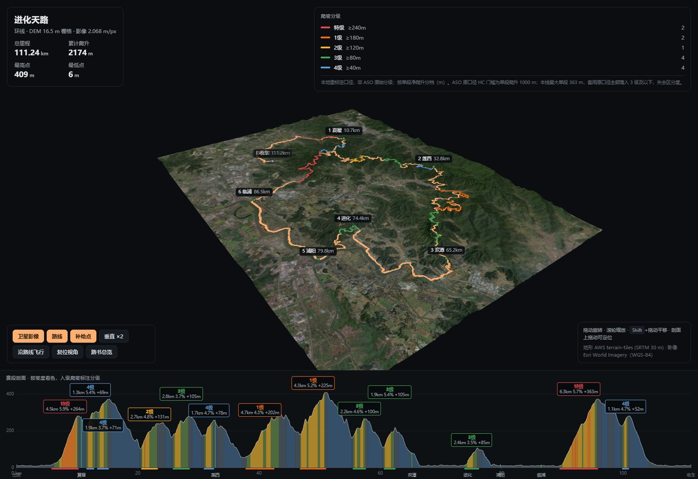

# route-studio

把一条 GPX 变成能看清地形、看清路的线路图：三维飞越视图 + 赛段剖面 + 路书总览。

渲染目标是环法转播里那种 flyover —— 真实卫星影像贴在真实地形上，路线是一条有宽度的
带子，按爬坡难度分级着色。



## 用法

```bash
./route-studio new <name> <file.gpx>   # 解析 GPX，写出 route.toml 草稿
$EDITOR routes/<name>/route.toml       # 唯一手工编辑的文件
./route-studio all <name>              # 抓 DEM + 影像，推导剖面，规划，构建
./route-studio serve <name>            # http://127.0.0.1:8799/terrain.html
./route-studio shot <name> [tag] [#…]  # 用 Windows Edge 截图
./route-studio list
```

`routes/<name>/data/` 下全部可由 GPX + `route.toml` 重新生成，不要手改。

`route.toml` 里只放**测不出来的东西**：标题、爬坡分级阈值、渲染参数、
以及补给点（哪儿算补给、靠不靠得住、停多久、买什么）。其余一律计算 ——
坐标、海拔、剖面、分段、无补给空档、时刻表。没有 `[[supply]]` 也能出页面，
只是没有时刻表和路书表格。

页面必须经 http 打开（它 fetch `scene.json`/`scene.bin`，`file://` 的 opaque origin
会被 CORS 挡掉）。

## 页面

| | |
|---|---|
| `terrain.html` | 上下分栏：三维地形 + 赛段剖面。剖面上拖动可定位相机，「沿路线飞行」是追尾机位 |
| `roadbook.html` | 俯视路书：卫星/晕渲底图、里程桩、补给点标注，加四张表（时刻表/爬坡/分段/无补给空档），带打印样式 |

深链：`#km=8&dist=0.02&pitch=0.4&yaw=0.5&exag=2&sat=0&fly=1`

## 七个踩过的坑

**地形的几何精度到 30 m 就是上限。** 公开 DEM 在中国境内没有比 SRTM 30 m 更细的，
所以「更逼真」主要来自卫星影像（2.07 m/px，比地形网格细 8 倍），不是来自高程。

**地形网格不传顶点。** 第一版输出显式顶点 + 索引缓冲：98 万顶点、196 万三角形、
**55 MB**，而其中真正的信息只有 1.96 MB 的高程。x/y/uv/法线都能从网格位置算出来，
网格位置又能从 `gl_VertexID`/`gl_InstanceID` 算出来。所以只传 Int16 高程栅格，
页面按行画 instanced triangle strip。**28 倍压缩。**

**R16I 整数纹理在顶点着色器里读不出来**，而且不报编译错误 —— 地形渲成一块平板。
换 R32F 解决（传输仍是 Int16，只有 GPU 副本是 4 字节）。

**路带的宽度是屏幕空间的。** 「原来做的就是一个光线」——问题不在亮度，在于零宽度的
线没有体积感。但固定地面宽度也不行：7 m 在整条路线的视距下不足 1 像素。所以顶点只存
中心线 + 侧向单位向量，shader 按 `clip.w` 算出当前深度的「米/像素」，把半宽抬到
3.2 px 的下限。

**路带的高程要按网格的三角剖分取，并覆盖整条带宽。** 双线性采样值不在渲染三角面上；
而 7 m 宽的带子横跨 16.5 m 的栅格，侧坡上下侧那条边会插进地里（实测 14% 的路肩采样
被埋，最深 3.97 m）。取整条带宽的最高地形 + 1.2 m，埋入率降到 0%。

**`polygonOffset` 的第一个参数按深度斜率缩放。** 追尾视角下路带近乎掠射，斜率极大，
而三角带里相邻三角形朝向交替 —— 于是一条被推到前面、一条留在后面，整条路成了横向
条纹的梯子。几何自己离地之后，这个偏移不再需要，删掉。

**往返重合段必须横向错开。** 这条是棒糖路线，「柄」段骑两遍，两条路带几乎完全重合、
互相 z-fighting，渲出来是去程色和回程色交替的条纹 —— 看着像 shader bug，其实像素
如实反映了两段不同的里程。检测出第二遍（本线 19% 的点）并向一侧偏移一个路宽，
问题消失，而且往返结构变成了可读信息。

## 爬坡分级是本地重标定的

ASO 原口径 HC 门槛是单段爬升 1000 m。进化天路最大单段 363 m，直接套用会把全部
14 段压进「3 级及以下」，失去区分度。`route.toml` 的 `categories` 按中国东部丘陵
重定五档，页面上明确标注这是自定义口径并附 ASO 换算说明 —— 偷套 ASO 的标签才是误导。

## 分段口径：自建的那套更准

旧管线（opentopodata 点查）把连续爬坡拆碎了。进化天路全程最高点 408.6 m 那段，
实际是从 46.7 km 连续爬 **+225 m / 5.2%**，而旧分段在 48.5 km 处断开，算成
**+83.6 m / 2.4%（3 级）** —— 把本线最硬的一个坡降了两级。89.6→95.9 km 同理，
被拆成 +237.8 m 和 +52.3 m 两截，实际连续 +362 m。两处都用高程剖面逐段验算过，
自建分段与实测吻合到 1 m 内。

代价：累计爬升从 2041 变成 2174 m（+6.5%）。两者都是 SRTM，差异来自采样方式
（API 点查 vs 栅格双线性）—— 累计爬升对采样和平滑本来就敏感，不是其中一个错。
`use_derived_profile = false` 可以切回旧分段。

## 坐标系

影像默认 Esri World Imagery，因为它是 **WGS-84**，和 GPX 同基准，零纠偏。
`sat_source = "amap"` 可切高德（国内持证服务商），但它是 GCJ-02，在这一带和 WGS-84
差约 490 m：全程缩放下看不出来，街道级就比路本身还宽 —— 而「看得清是路」正是这个
页面的卖点。切过去就得自己在下游纠偏。

## 剖面为什么不按坡度着色

按坡度分段实测中位段长 481 m，而全程视图是 12.1 px/km —— 每段只有
**5.8 像素**。六种颜色挨着排就是彩虹噪点，不是信息。（中途试过把坡度分成
8 档来拉开色差，段更碎、条纹更糟，已回退。）

改成**按爬坡分级填色**：27 段、中位 36 px，而且和 3D 路线、图例三者同色。
非爬坡段用中性蓝灰 —— 原来的暖橙和 1 级的 `#f76b15` 太近，占 66% 的
非爬坡段在地图上看着像一条超长的 1 级爬坡。

## 已知未完成

- **补给点必须人工录入。** `route.toml` 的 `[[supply]]`。`reliable = false`
  是安全阀：景区摊点、山中驿站算**不是**补给，标错会把全程最长的无补给
  空档藏起来。
- 剖面与三维还没有反向联动（飞行时剖面游标会走，但三维里拖动不回写剖面）。
- 速度模型是标定出来的、不是物理的：对着天路那份人工 plan 拟合，111 km
  上和它差 27 分钟。排序和空档可信，分钟级不必当真。
- 影像抓取对 Esri 有限流风险：天路 1036 个瓦片，608 个时掉过一次连接，
  靠缓存续抓（延迟调到 0.5 s）跑完。覆卮山 1386 个（只抓了 980 个就停了）。
- 累计爬升是方法相关量，见上节。页面上没有标注用的是哪种口径。
- 三维视图上方仍有一片空白。相机已改成按**路线**范围取景而非整个 DEM
  （路线只占 bbox 的 72%×79%），但再压就会伤到地形形状：把瞄准点往北抬、
  或把俯仰角从 0.52 提到 0.78，前者把地形推到画面下半，后者让 DEM 远边缘
  挤进视锥顶点、矩形地块渲成尖角。两次都回退了。

## 数据来源

| | |
|---|---|
| 高程 | AWS terrain-tiles（terrarium 编码的 SRTM 30 m），z13 ≈ 16.5 m/px |
| 影像 | Esri World Imagery，z16 ≈ 2.07 m/px |
| 路线 | GPX（原始 `<ele>` 全为 0 时自动忽略，高程一律来自 DEM） |
